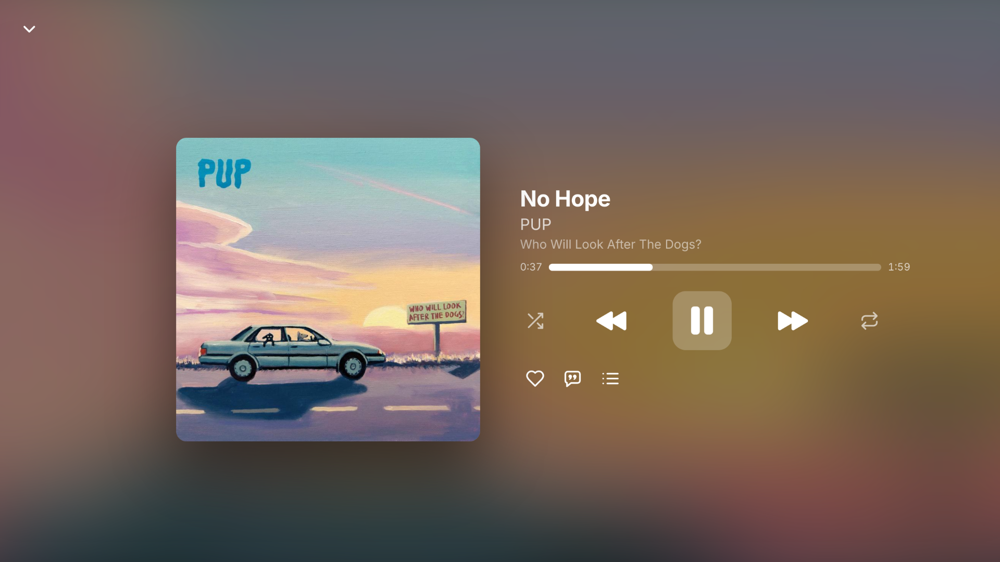

<p align="center">
  
</p>

# Couchtunes

*Formerly called Cadence.*

An Apple Music-style player for your own [Navidrome](https://www.navidrome.org) server, made for the living-room screen.

I wanted to create a good Navidrome app for LG WebOS and for Desktop PC Consoles (Fullscreen with TV and controller naviation in mind) so I decided to build Couchtunes.

Couchtunes talks to any Subsonic or OpenSubsonic server and is designed to be driven from across the room: arrow keys, a TV remote or a game controller. It also works fine with a mouse and keyboard on a computer.

> Couchtunes is an independent project. It is not affiliated with Apple or Navidrome, and "Apple Music-style" only describes the look.

> **How it was made:** Couchtunes was written with AI (Claude, by Anthropic) and tested heavily by hand by its maintainer, on a real LG webOS TV and on the desktop. Treat it like any other open-source project: read the code if you care, and report anything that doesn't work.

## Screenshots
### Listen Now

### Now Playing

### Lyrics

### Library: Albums

### Library: Artists

### Album View

### Artist View
| Artist View  | Artist View |
|---|---|
|  |  |
### Search Page


| Settings | Keyboard shortcuts | TV remote shortcuts |
|---|---|---|
|  |  |  |

| PlayStation controller | Xbox controller |
|---|---|
|  |  |

### Quit Menu (For PCs to exit with the controller)


## Features

- Listen now, Library (albums, artists, playlists, compilations, genres, songs, composers), Favorites and Search
- Album, artist and playlist pages with top songs and artist links
- Now Playing with an Up next queue
- Synced lyrics with animated intro and instrumental dots
- Search with an on-screen keyboard, recent searches and browse tiles
- Internet radio: stations you add in Navidrome appear in the Library (Radios) and on Listen now. Nothing shows if you have none.
- Focus navigation with a lifted, white highlight, like a TV interface
- Game controller support, including a PlayStation layout in the shortcuts window
- Light, dark and automatic themes, selectable streaming quality, adjustable skip steps
- Hover effects for mouse use, and a keyboard and controller shortcuts window (press `?`)
- A Quit Menu on the desktop so you can exit the app with the controller
- One HTML file, no build step and no tracking. Your password is never stored, only a Subsonic token

## Install

Download the latest files from the [Releases](../../releases) page.

| Platform | File | How |
| --- | --- | --- |
| **LG webOS TV** | `com.cadence.navidrome_*_all.ipk` | Needs a TV in developer mode or rooted with the Homebrew Channel. `ares-install --device <tv> com.cadence.navidrome_*_all.ipk` |
| **LG webOS (Homebrew Channel)** | repository link | In Homebrew Channel: Settings, Add repository, then paste `https://captechomar.github.io/Couchtunes/apps.json` |
| **Linux (any)** | `Couchtunes-*-linux-x86_64.AppImage` | `chmod +x` it and run it. It carries update information, so [Gear Lever](https://flathub.org/apps/it.mijorus.gearlever) (or AppImageUpdate) can update it for you |
| **Linux (Flatpak)** | [`couchtunes.flatpakref`](https://captechomar.github.io/Couchtunes/flatpak/couchtunes.flatpakref) | `flatpak install --user https://captechomar.github.io/Couchtunes/flatpak/couchtunes.flatpakref`. After that, updates come with `flatpak update` or your software center. |
| Linux (Flatpak beta) | [`couchtunes-beta.flatpakref`](https://captechomar.github.io/Couchtunes/flatpak/couchtunes-beta.flatpakref) | `flatpak install --user https://captechomar.github.io/Couchtunes/flatpak/couchtunes-beta.flatpakref`. Gets the pre-releases. Start it with `flatpak run io.github.captechomar.Couchtunes//beta`. |
| Linux (Flatpak file) | `Couchtunes.flatpak` | `flatpak install --user ./Couchtunes.flatpak` (no automatic updates) |
| **Windows** | `Couchtunes-*-windows-portable.exe` | Run it. No installer, and nothing is written outside its own settings folder |
| **Any browser** | `src/index.html` | Open it, or add `?tv` for the TV layout. The server must allow cross-origin requests |

The desktop apps start full screen. Press `F11` to toggle it, and `Esc` on the first page to get the Quit prompt.

Sign in with your server address, user name and password. For a server behind HTTPS, use the full address, for example `https://music.example.com`.

## Controls

Press `?` or `F1` in the desktop app, or open Settings and choose Shortcuts, to see these in the app.

| Keyboard | Action |
| --- | --- |
| `K` or `Ctrl`+`Space` | Play / pause |
| `,` or `Ctrl`+`←` | Previous song |
| `.` or `Ctrl`+`→` | Next song |
| `N` or `Ctrl`+`Enter` | Now Playing |
| Arrow keys, `Enter`, `Esc` | Move, choose, go back |
| `←` `→` on the seek bar | Skip back / forward |

| Controller | Action |
| --- | --- |
| D-pad or left stick | Move |
| A (✕) / B (○) | Choose / back |
| X (□) | Play / pause (delete a letter on Search) |
| Y (△) or Start | Now Playing (capitals on Search) |
| LB / RB | Previous / next |
| LT / RT | Skip back / forward |

## Build from source

You need Node.js 20 or newer.

```sh
# desktop app (Linux and Windows)
cd desktop
npm install
npm start                # run it
npm run dist:linux       # AppImage and unpacked app, in desktop/dist
scripts/make-zsync.sh desktop/dist/*.AppImage <github-user> <repo>   # adds update info and the .zsync file (needs the zsync package)
npm run dist:win         # Windows portable .exe (build it on Windows)

# LG webOS package
scripts/build-webos.sh   # writes dist/webos/*.ipk

# Flatpak (after dist:linux). Uses your GitHub name to make the app id
scripts/build-flatpak.sh <github-user>
```

A tagged release (`v1.2.3`) builds all of these on GitHub Actions and attaches them to the release.

## Project layout

```
src/index.html   the whole app
webos/           LG webOS package files
desktop/         Electron shell for Linux and Windows
flatpak/         Flatpak manifest and appstream data
scripts/         build helpers
```

## Contributing

Issues and pull requests are welcome. See [CONTRIBUTING.md](CONTRIBUTING.md).

## License

[MIT](LICENSE). The desktop builds include Electron, which is MIT licensed, and Chromium, whose licenses ship inside each build.

Ogg Opus playback on TVs uses [ogg-opus-decoder](https://github.com/eshaz/wasm-audio-decoders) (MIT, © Ethan Halsall), embedded in the app. Added by [@Grumley](https://github.com/Grumley) in #3.
